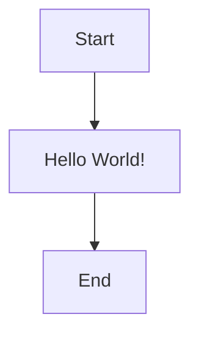
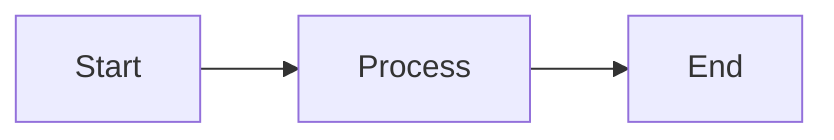
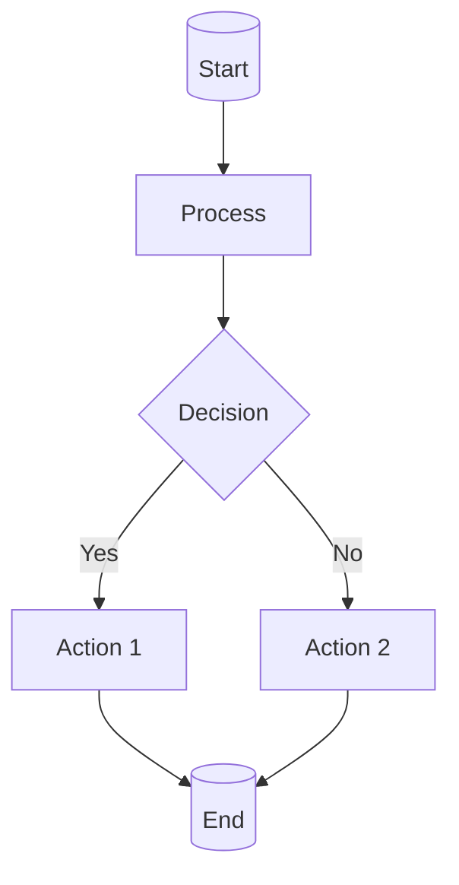
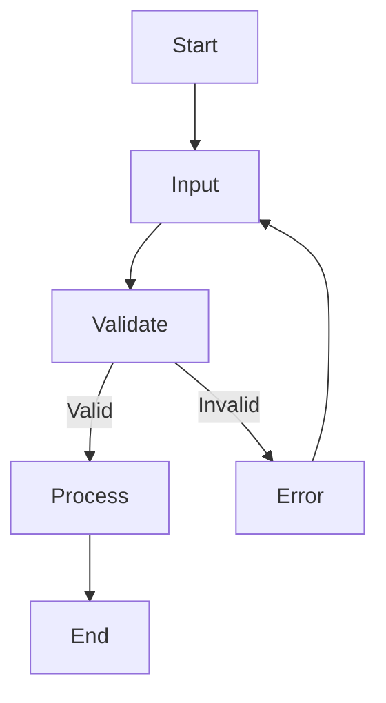
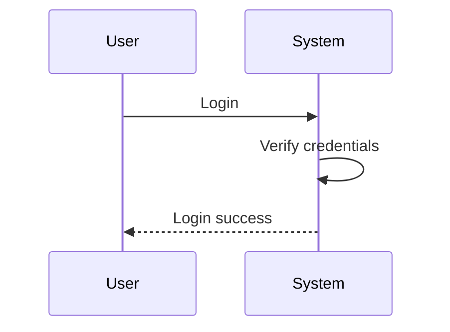
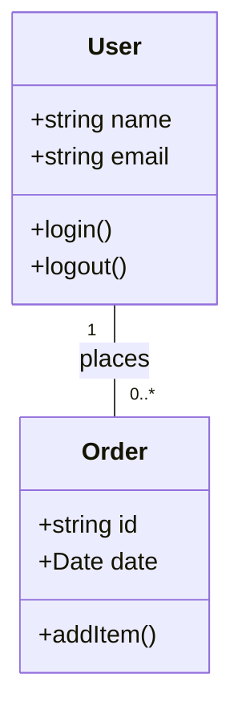

# Quick Start Guide

Get up and running with MermaidStudio in minutes!

## 1. First Time Setup

### Open MermaidStudio
1. Navigate to [www.mermaidstudio.net](https://www.mermaidstudio.net)
2. The app loads directly in your browser
3. No sign-up required — everything is stored locally on your device (IndexedDB)

### Familiarize Yourself
- **Sidebar**: Your files and folders
- **Workspace**: Editor tabs (Code + live Preview side by side, or the drag-and-drop **Visual** editor)
- **Status Bar**: Current status and info

> **What's new**: preview **zoom controls** (v1.7), **French UI** (switch EN/FR in the menu, v1.6), and **12 new node shapes** in the visual editor — including `double-circle`, written `((( Node )))` or `@{ shape: double-circle }` (v1.5).

## 2. Create Your First Diagram

### Option A: From Scratch
1. Click **"New Diagram"** in the toolbar
2. Type your Mermaid code in the editor
3. See live preview update automatically

### Option B: Use a Template
1. Click **"Templates"** button
2. Choose from categories (Flowcharts, Sequences, etc.)
3. Click "Use Template"

### Option C: Generate with AI
1. Click lightning bolt icon (**"AI Generate"**)
2. Type: "Create a simple flowchart"
3. Generate — the AI runs **in-browser on your GPU** (WebGPU), no account or API key needed

## 3. Basic Editing

### Simple Flowchart

- **Type directly** in the editor
- **Preview updates** as you type
- **Errors** show in red text

### Common Elements

### Keyboard Shortcuts
- `Ctrl/Cmd + S` - Save
- `Ctrl/Cmd + N` - New
- `Ctrl/Cmd + K` - Command palette
- `Ctrl/Cmd + /` - Toggle AI panel
- `F11` - Fullscreen preview

## 4. Save and Organize

### Saving Diagrams
1. **Auto-save** happens as you type
2. **Manual save** with `Ctrl + S`
3. **Save As** to create a copy

### Creating Folders
1. Click **"+"** in sidebar
2. Enter folder name
3. Drag diagrams into folders

### Adding Tags
When saving:
1. Enter tags separated by commas
2. Example: `flowchart, user, onboarding`

## 5. Export Your Work

### Quick Export
1. Click **"Export"** button (or `Ctrl/Cmd + E`)
2. Choose format:
   - PNG (for documents)
   - SVG (scalable)
   - Copy as Markdown, embed code, or share link

### Share Online
1. Click **"Share"**
2. Copy the link — the diagram is encoded in the URL itself
3. Anyone opening the link sees the diagram in their browser; nothing is uploaded to a server

## 6. Advanced Features

### AI Assistance
- **Generate**: "Create user login flow"
- **Fix**: Select error + "Fix with AI"
- **Improve**: Select text + "Improve with AI"

### Version History
1. Click **"History"** (in the workspace "More" menu)
2. See the last 50 versions
3. Restore any version with one click

### Visual Editor
1. Click **"Visual Editor"**
2. Drag shapes onto canvas
3. Connect nodes automatically
4. Style with colors and fonts

## 7. Common Tasks

### Creating a Flowchart

### Creating a Sequence Diagram

### Creating a Class Diagram

## 8. Troubleshooting

### Preview Not Working?
- Check for syntax errors — the preview shows the mermaid error message
- Ensure brackets are closed
- Use **Fix with AI** from the AI panel

### AI Not Responding?
- The AI runs locally on your GPU via **WebGPU** — no API key or internet model download mid-session
- Use a WebGPU-capable browser (Chrome or Edge; Safari support varies)
- Pick a smaller machine size ("low") in the AI settings if loading fails

### Slow Performance?
- Close unused tabs
- Clear browser cache
- Use incognito mode

## 9. Tips & Tricks

### Productivity Tips
1. **Use templates** for common diagrams
2. **Keyboard shortcuts** save time
3. **AI assistance** speeds up creation
4. **Version history** prevents data loss

### Best Practices
1. **Start simple**, then add complexity
2. **Use comments** (`%% This is a note`)
3. **Organize** with folders and tags
4. **Export important** diagrams regularly

## Need Help?

- **Help Menu**: Click Help in the app
- **Keyboard Shortcuts**: See full list in Help
- **Report Issues**: [GitHub repository](https://github.com/CatFoxVoyager/MermaidStudio/issues)

---

**Next Steps**:
- Try the [full tutorials](./tutorials.md)
- Check out the [API documentation](../api/README.md)

Happy diagramming! 🎨

*Updated: 2026-11-03*